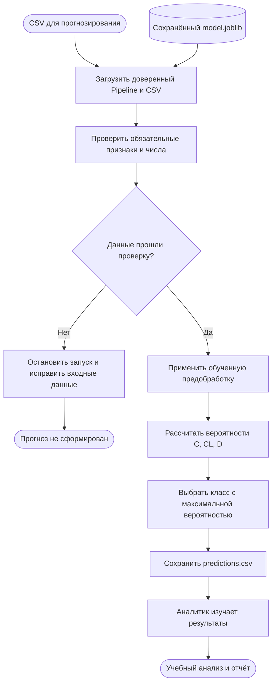

# Место модели в процессе проекта

## Назначение

Проект решает учебную задачу классификации статуса наблюдения при циррозе печени по табличным данным. Рабочая модель — логистическая регрессия из `src/cirrhosis_prediction`, объединённая с предобработкой в sklearn Pipeline. Подробности и ограничения: [model_card.md](model_card.md).

ML позволяет оценить совместную связь множества числовых и категориальных признаков с тремя классами по размеченным примерам. Логистическая регрессия служит воспроизводимой базовой моделью для сравнения с более сложными алгоритмами. Полезность для реальных клинических решений текущими экспериментами не установлена.

## Схема технического процесса

Схема Mermaid описывает последовательность задач и развилки; это не формальная BPMN 2.0-модель. Основной сценарий — уже реализованное пакетное прогнозирование. Обучение выполняется отдельно и создаёт используемый артефакт.



При ошибке загрузки модели или чтения CSV запуск также завершается с ошибкой. Встроенного автоматического исправления данных нет.

## Этапы и передаваемые результаты

| Этап | Что происходит | Что передаётся дальше |
| --- | --- | --- |
| Подготовка входа | Аналитик формирует CSV с 18 признаками в схеме обучения; истинный Status не нужен | Входной CSV, необязательный id |
| Загрузка | Скрипт загружает CSV и доверенный сохранённый Pipeline | Таблица и обученная модель |
| Проверка | Проверяются столбцы, непустой набор, преобразуемость чисел и отсутствие бесконечностей | Признаки в ожидаемом порядке либо исключение |
| Предобработка | Применяются сохранённые заполнение пропусков, масштабирование и кодирование; повторного fit нет | Матрица признаков |
| Работа модели | predict_proba вычисляет вероятности трёх классов | Три вероятности для каждой строки |
| Выбор класса | Выбирается класс с максимальной вероятностью | Status и вероятности |
| Сохранение | Формируется CSV, при наличии переносится id | `artifacts/predictions.csv` |
| Использование | Аналитик анализирует распределения и примеры; при наличии независимых истинных меток может отдельно оценить ошибки | Учебный отчёт и предложения по улучшению |

Числовые признаки: N_Days, Age, Bilirubin, Cholesterol, Albumin, Copper, Alk_Phos, SGOT, Tryglicerides, Platelets, Prothrombin, Stage. Категориальные: Drug, Sex, Ascites, Hepatomegaly, Spiders, Edema.

## Пример запуска

```bash
poetry run cirrhosis-predict --model artifacts/model.joblib --input data/raw_data.csv --output artifacts/predictions.csv
```

Это проверка интерфейса на доступном CSV. Для оценки обобщения требуется независимая выборка. Автоматическое назначение лечения, API и интеграция с медицинской системой в текущий процесс не входят. Из-за признака N_Days этот сценарий нельзя без дополнительной переработки представлять как раннее прогнозирование риска.
