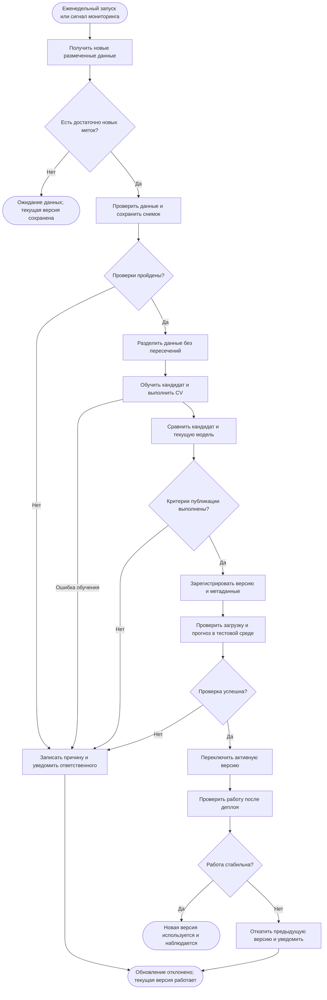

# Процесс автоматического переобучения модели

## Область применения и статус

Ниже спроектирован процесс для учебного проекта `project_case6`, использующего Pipeline предобработки и логистической регрессии. В репозитории уже есть ручной запуск обучения, оценка, сохранение модели и пакетное прогнозирование. Планировщик, мониторинг, реестр версий, автоматическое сравнение и деплой — предлагаемые расширения, а не утверждение об их наличии.

Под деплоем здесь понимается публикация проверенного артефакта для учебного пакетного прогнозирования. Клиническое внедрение не рассматривается. Mermaid используется как схема процесса с задачами, событиями и развилками, без заявления о соответствии формальной BPMN 2.0.

## Схема

## Этапы и результаты

| Этап | Действие | Результат следующему этапу |
| --- | --- | --- |
| Триггер | Планировщик раз в неделю проверяет новые данные; дополнительный сигнал — ухудшение Log Loss на свежих размеченных данных | run_id, причина и время запуска |
| Получение | Загружается новая версия CSV с признаками и подтверждённым Status; прогнозы модели не используются как истинные метки | Новая размеченная партия |
| Готовность | Проверяется наличие новых записей и достаточного числа примеров каждого класса для оценки и CV | Разрешение запуска либо ожидание меток |
| Валидация | Проверяются схема, типы, допустимые категории, пропуски цели, диапазоны по согласованному контракту, дубликаты и доступность признаков во времени | Проверенный снимок данных, SHA-256, отчёт |
| Подготовка | Новые записи объединяются с разрешённой историей; выделяется независимая оценочная часть, исключаются пересечения пациентов и дубликатов | Train, validation и release-test с сохранёнными идентификаторами |
| Обучение | Создаётся новый Pipeline; импутация, масштабирование и кодирование обучаются внутри фолдов; параметры выбираются только по train/CV/validation | Кандидат, конфигурация и CV-метрики |
| Проверка качества | Кандидат и действующая версия оцениваются на одной независимой release-test выборке; считаются Log Loss, F1 macro, recall по классам | Сравнительный отчёт и решение о публикации |
| Регистрация | Прошедший отбор кандидат сохраняется в отдельной неизменяемой папке версии | model.joblib, metrics.json, metadata.json, контрольная сумма |
| Тестовый запуск | В отдельном окружении проверяются загрузка, схема выхода, конечность вероятностей и их сумма, обработка контрольного CSV | Отчёт smoke-теста |
| Деплой | После всех проверок атомарно обновляется указатель активной версии; предыдущая сохраняется | Новая активная версия для пакетных запусков |
| Наблюдение | Проверяются ошибки, время обработки, входные распределения, а при поступлении меток — качество | Метрики мониторинга, сигнал переобучения или отката |

## Предлагаемые условия запуска и публикации

Пороговые значения ниже — проектные настройки учебного процесса, а не результаты измерений и не клинические нормативы. Их фиксируют до запуска, затем меняют только с обоснованием.

1. Плановая проверка — раз в неделю. Переобучение запускается при наличии не менее 300 новых размеченных строк. В release-test требуется не менее 30 примеров каждого класса, в обучающей части — не менее 5 каждого класса для пятифолдовой CV. Если условия не выполнены, запуск откладывается.
2. Дополнительный триггер — рост Log Loss действующей версии более чем на 10% относительно зафиксированного мониторингового уровня на двух последовательных непересекающихся размеченных окнах, каждое не менее 300 строк и с представленными тремя классами. Без меток можно выявить дрейф признаков, но нельзя вычислить фактическое качество или автоматически разрешить публикацию.
3. Для публикации Log Loss кандидата должен быть как минимум на 1% ниже Log Loss текущей версии на той же release-test выборке; F1 macro не ниже текущего; recall каждого класса не ниже текущего более чем на 0.02. Все метрики должны быть конечными. Если действующей версии нет, автоматическое сравнение невозможно: первая версия утверждается отдельно по заранее согласованным абсолютным критериям.
4. Все проверки данных, тесты пакета и smoke-тест должны завершиться успешно. Вероятности должны лежать в [0, 1], их сумма по строке должна отличаться от 1 не более чем на 1e-6; число выходных строк должно совпадать с входом.

## Защита от утечки и воспроизводимость

Текущий `train.py` делает стратифицированный split 80/20 с seed=8 и пятифолдовую CV. Для многократного автоматического выпуска его потребуется расширить: передавать заранее определённые разбиения и сравнивать две версии на общей независимой выборке. При временных данных оценивается более поздний период; при повторных наблюдениях одного пациента разбиение выполняется по пациентам. Без надёжных идентификаторов независимость пациентов не считается доказанной.

Release-test не используется для подбора параметров; после отклонения нельзя многократно подстраивать кандидаты под этот тест. Следующий цикл использует новую заранее выделенную оценочную партию. Исторический тест из VALIDATION.md не превращается в бесконечно повторяемый критерий отбора.

Признаки, недоступные в момент прогноза, исключаются до обучения. В частности, для раннего прогноза необходимо пересмотреть N_Days. При изменении набора признаков обе сравниваемые модели должны соответствовать одному назначению; нельзя сравнивать разные задачи только по числу Log Loss.

Для каждого запуска сохраняются commit кода, версия данных и SHA-256, seed, параметры, версии Python/scikit-learn, lock-файл окружения, разбиения и результаты проверок. При обучении используются отдельные пути `artifacts/runs/<run_id>/`; прошедшие проверку версии размещаются в `artifacts/versions/<version>/`. Эти пути и указатель активной версии предлагаются как расширение; текущий скрипт по умолчанию перезаписывает `artifacts/model.joblib`.

## Ошибки и откат

- Неверные данные: партия изолируется, сохраняется отчёт; действующая модель не меняется.
- Ошибка обучения или недостаточное качество: кандидат помечается отклонённым, сохраняются логи и метрики.
- Ошибка регистрации или тестового запуска: активный указатель не переключается.
- Ошибка переключения: сохраняется либо восстанавливается указатель предыдущей версии; частично записанный файл не используется.
- После деплоя ошибка загрузки, некорректная схема/вероятности или сбой контрольного пакетного запуска вызывают откат. Дальнейшее ухудшение качества по новым меткам приводит к сравнению с сохранённой предыдущей версией на том же окне и откату, если она удовлетворяет критериям лучше.
- Если восстановление не удалось, пакетное прогнозирование останавливается с явным сообщением, а не выдаёт непроверенные результаты. Ответственный получает уведомление; повторный запуск выполняется после устранения причины.

Связанные документы: [карточка модели](model_card.md), [процесс использования](Model_BPMN.md), [результаты исходной проверки](VALIDATION.md).
